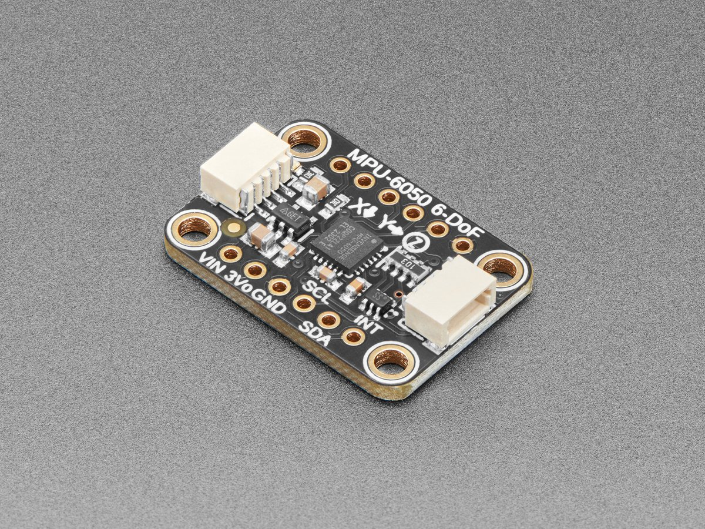
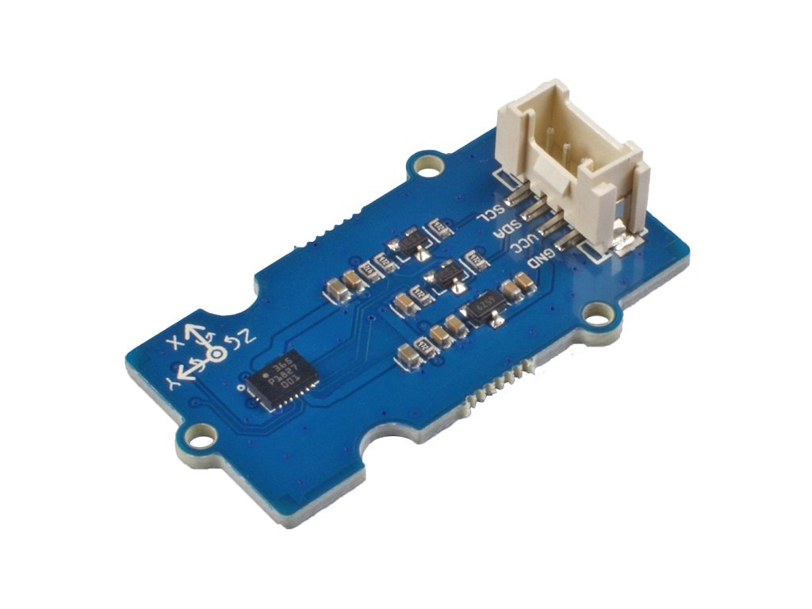

# imu

<p align="center">
  
  
  
</p>

A small Linux-IIO-style IMU subsystem for ESP-IDF and the STM32 HAL (F4 and
F7), plus four chip drivers: the InvenSense MPU-6050 (I2C), the TDK InvenSense
ICM-45686 (SPI), the Bosch BMI088 (I2C or SPI) and the WitMotion WT901C-TTL
module (serial). Every chip's probe fills
one `struct imu_dev`, and from then on `imu_read()` gives you the same
`struct imu_sample` whatever the chip is: acceleration in m/s², angular rate
in rad/s, die temperature in °C, a timestamp from `imu_time_us()`, and your
board's mounting rotation applied. Every call returns 0 or a negative errno.
Chip-specific settings (ranges, rates, filters, power) stay chip-specific.

**One library, two platforms.** It replaces esp-imu and stm-imu. The chip
drivers in `src/` are the same C on both; only the bus, the clock and the
waits under them differ, in `src/imu_port_esp.c` (ESP-IDF `i2c_master`,
`spi_master`, `esp_timer`, FreeRTOS) and `src/imu_port_stm.c` (HAL). Each
port is empty on the other platform, chosen by `ESP_PLATFORM`, which ESP-IDF
defines for every component. Probes and configs take the platform's own
handles, exactly as the two old libraries did, so apps of either build
unchanged: on ESP-IDF an `i2c_master_bus_handle_t`, an SPI host and CS pins,
and clocks the driver sets; on the HAL an `I2C_HandleTypeDef *`, an
`SPI_HandleTypeDef *` and CS port/pin pairs, with the clock the handle's.

**One bus layer.** Under the chips sits a regmap-style ops table, `struct
imu_bus_ops` in `src/imu_priv.h`: each chip holds one `struct imu_bus` per
device and talks to it only through `transfer(cmd, tx, rx)`. The kind —
I2C, SPI or UART — is picked at run time by which attach the probe calls.
The BMI088 holds two, one per die: a die is just an I2C address or a chip
select, which is what a bus instance is. Its accelerometer's SPI dummy byte
stays in the chip driver.

`imu_uart_attach()` takes a `uart_port_t` whose driver the app has installed
on ESP-IDF, or a `UART_HandleTypeDef *` it has initialised on the HAL. Each
transfer drops stale input, sends the command byte and its arguments, then
waits for the whole answer; one that stops short is `-ETIMEDOUT`. A part that
streams on its own instead of answering, like the WT901, has one more op,
`receive(rx, n, drop_stale)`: wait for n bytes with nothing sent, dropping
whatever was already waiting first if asked. It is UART-only; I2C and SPI
leave it NULL and `imu_bus_receive()` says `-EOPNOTSUPP`. On the HAL the UART
code sits under `HAL_UART_MODULE_ENABLED`, so an app without the UART module
builds as before.

> **Hardware unverified.** The host tests in `test/` pass. Nothing here has
> run on a physical chip.

## Install

**With [esp-forge](https://github.com/JonasAtelier/esp-forge) or
[stm-forge](https://github.com/JonasAtelier/stm-forge).** The catalog line in
`profiles/pkgversion` is the same for both:

```make
imu_GIT=https://github.com/JonasAtelier/imu@stable
```

and a target turns the library and its chips on in `configs/<target>_defconfig`:

```make
PKG_imu             = y
IMU_MPU6050         = y
# IMU_ICM45686 is not set
# IMU_BMI088 is not set
# IMU_WT901 is not set
```

or with `make menu`. esp-forge turns each line into `CONFIG_IMU_<CHIP>=y` in
`sdkconfig.defaults`; stm-forge passes it as `-DCONFIG_IMU_<CHIP>=1`.
`IMU_DEBUG = y` turns on `imu_dbg()` lines on the HAL; on ESP-IDF the log
level decides.

**Plain ESP-IDF.** Clone into your project's `components/` directory. A local
component is named after its directory, and that name is what you
`REQUIRES`:

```sh
git clone https://github.com/JonasAtelier/imu components/imu
```

```cmake
idf_component_register(SRCS "main.c" REQUIRES imu driver)
```

Enable the chips under `idf.py menuconfig` → **Component config → IMU
subsystem**, or put `CONFIG_IMU_<CHIP>=y` in your `sdkconfig.defaults` as each
example in `examples/esp/` does. With the subsystem on and no chip picked,
the build warns. ESP-IDF 5.2 or newer is required for the `i2c_master` API.

**Anywhere else on STM32.** Copy `include/` and `src/` into an STM32 project, compile
`src/*.c`, add `include/` to the include path, and define what the forge
would: `CMSIS_device_header` as your family header (`"stm32f4xx.h"` or
`"stm32f7xx.h"`), `USE_HAL_DRIVER`, and `CONFIG_IMU_<CHIP>=1` for each chip
you want.

**No chip driver is built by default.** Like a kernel subsystem, the core is
always built and each driver is opt-in: a chip whose option is absent or 0
compiles to nothing. With the library on and no chip picked, the ESP-IDF
CMakeLists warns and `src/imu_port_stm.c` emits a `#warning`.

The rest of this section is the STM32 HAL's.

**The HAL modules are yours to enable.** The drivers call the HAL's I2C and
SPI, so your app's `stm32f4xx_hal_conf.h` (or `stm32f7xx_hal_conf.h`) must
define the module each chip uses, and its `.c` must be in the build:

| Option | Needs in hal_conf | HAL source |
|---|---|---|
| `IMU_MPU6050` | `HAL_I2C_MODULE_ENABLED` | `stm32f{4,7}xx_hal_i2c.c` |
| `IMU_ICM45686` | `HAL_SPI_MODULE_ENABLED` | `stm32f{4,7}xx_hal_spi.c` |
| `IMU_BMI088` | both | both |
| `IMU_WT901` | `HAL_UART_MODULE_ENABLED` | `stm32f{4,7}xx_hal_uart.c` |

stm-forge's `mcu/stm32f4.cmake` and `mcu/stm32f7.cmake` already list both
sources, plus `_hal_i2c_ex.c` (for the `HAL_I2CEx_ConfigAnalogFilter()` that
CubeMX-style init calls) and the F7's `_hal_spi_ex.c`; each compiles to
nothing until hal_conf enables its module. A chip
whose module is off stops the build with an `#error` that says which define
is missing.

**printf() is the log.** Lines go out through `printf()`, so retarget
newlib's `_write()` to a UART. stm-forge links newlib-nano
(`--specs=nano.specs`), whose `printf()` drops `%f` unless the app links with
`-u _printf_float`: add `target_link_options(firmware PRIVATE -u _printf_float)`
to your app's `CMakeLists.txt`, or `imu_log_sample()` prints blanks where the
numbers go.

## Pins

On ESP-IDF any GPIO works; the examples in `examples/esp/` set theirs at the
top of `main.c`. On STM32, pins are the ones the examples in `examples/stm/`
use, on an F4: I2C1 on PB8/PB9 (AF4), SPI1 on
PA5/PA6/PA7 (AF5), chip selects on PD14/PD15. Any pin your chip routes to the
same peripheral works; check the alternate-function table in its datasheet.
The bus init — pins, clocks, speed, SPI mode — is the app's; each example
shows one.

### MPU-6050 — `examples/*/mpu6050`

| pin | goes to | note |
|---|---|---|
| VDD | 3.3 V | the bare chip is 3.3 V only. A GY-521 has a regulator and takes 5 V too |
| VLOGIC | 3.3 V | the separate I/O supply; tie it to VDD unless you are level shifting |
| GND | GND | shared ground, always |
| SDA | PB9 | I2C1_SDA, AF4, open drain |
| SCL | PB8 | I2C1_SCL, AF4, open drain |
| AD0 | GND | low is 0x68, high is 0x69 (`.address = 0x69`). Those are the only two, so two chips per bus |
| INT | not used by this driver; leave open | `mpu6050_data_ready()` reads `INT_STATUS` over I2C instead |
| AUX_DA, AUX_CL | a magnetometer, or open | the auxiliary bus — see [The auxiliary bus](#the-auxiliary-bus) |

A GY-521 silkscreens AUX_DA and AUX_CL as XDA and XCL and labels VDD as VCC.
Both it and the Adafruit board pictured [below](#mpu-6050) regulate their
input, so they take 3.3 V or 5 V where the bare chip does not.

### ICM-45686 — `examples/*/icm45686`

| pin | goes to | note |
|---|---|---|
| VDD | 3.3 V | TDK rates the part for 1.71–3.6 V. No datasheet ships here, so check your breakout |
| VDDIO | 3.3 V | the interface supply, and it sets the logic level. Match the STM32 |
| GND | GND | shared ground, always |
| SCLK | PA5 | SPI1_SCK, AF5 |
| SDI | PA7 | SPI1_MOSI, AF5 |
| SDO | PA6 | SPI1_MISO, AF5 |
| CS | PD14 | a plain GPIO output, idle high; one per chip on the bus |
| INT1, INT2 | nothing | not used by this driver; `icm45686_data_ready()` reads `INT1_STATUS0` over SPI instead. Leave open |

SPI mode 3, 8-bit frames, at most 24 MHz. No I2C or I3C rows: this driver is
SPI only, whatever the part can do. Breakouts label `SDO` as **AD0**, because
it doubles as the I2C address bit on parts wired for it.

### BMI088 — `examples/*/bmi088` (I2C)

| pin | goes to | note |
|---|---|---|
| VDD | 3.3 V | analog and digital domain, 2.4–3.6 V |
| VDDIO | 3.3 V | interface supply, 1.2–3.6 V, and it sets the logic level |
| GNDA, GNDIO | GND | shared ground, always |
| PS | VDDIO | protocol select for the gyroscope: high is I2C. Sampled at power-on, not later |
| SCK / SCL | PB8 | I2C1_SCL, AF4, open drain |
| SDI / SDA | PB9 | I2C1_SDA, AF4, open drain |
| SDO1 | GND | accelerometer address: GND is 0x18, VDDIO is 0x19 |
| SDO2 | GND | gyroscope address: GND is 0x68, VDDIO is 0x69. **An MPU-6050 at 0x68 on the same bus collides with this** |
| CSB1 | VDDIO or open | accelerometer chip select. A rising edge switches it to SPI until power reset, so leave it alone on I2C |
| CSB2 | open | gyroscope chip select |
| INT1–INT4 | nothing | not used by this driver; leave open. `bmi088_data_ready()` reads both status registers instead |

### BMI088 — `examples/*/bmi088_spi` (SPI)

| pin | goes to | note |
|---|---|---|
| VDD | 3.3 V | analog and digital domain, 2.4–3.6 V |
| VDDIO | 3.3 V | interface supply, 1.2–3.6 V, and it sets the logic level |
| GNDA, GNDIO | GND | shared ground, always |
| PS | GND | protocol select for the gyroscope: low is SPI. Sampled at power-on, not later |
| SCK / SCL | PA5 | SPI1_SCK, AF5 |
| SDI / SDA | PA7 | SPI1_MOSI, shared by both dies |
| SDO1 | PA6 | SPI1_MISO, accelerometer |
| SDO2 | PA6 | gyroscope MISO, same wire as SDO1 |
| CSB1 | PD14, with a pull-up | accelerometer chip select. It starts in I2C mode; the probe's throwaway read gives it the rising edge that switches it to SPI until power reset |
| CSB2 | PD15, with a pull-up | gyroscope chip select. Both pull-ups keep the dies deselected while the STM32 boots |
| INT1–INT4 | nothing | not used by this driver; leave open |

SPI mode 0 (the example) or 3, 8-bit frames, at most 10 MHz.

Names are from table 14 of the [Bosch BMI088 datasheet](https://www.bosch-sensortec.com/media/boschsensortec/downloads/datasheets/bst-bmi088-ds001.pdf) (BST-BMI088-DS001). The
MPU-6050 and ICM-45686 names are the chips' usual ones; neither datasheet
ships in this repo.

## Use

Initialise the bus, probe, then read:

```c
static struct imu_dev imu;           /* zeroed; mount all zero = chip frame */
struct imu_sample s;

if (mpu6050_probe(&imu, &hi2c1, &cfg))  /* probe logs why it failed */
	return;

if (!imu_read(&imu, &s))
	imu_log_sample(&imu, &s);
```

One `imu_log_sample()` line looks like this (values illustrative):

```
imu: mpu6050: t 1234000 us  a   0.012  -0.034   9.801 m/s^2  g   0.001  -0.002   0.000 rad/s   27.4 C
```

The other two chips are the same after the probe:
`icm45686_probe(&imu, &cfg)`, `bmi088_probe_i2c(&imu, &bus_cfg, NULL)` or
`bmi088_probe_spi(...)`. Tear down with the matching `*_remove(&imu)`.

**Bus handles on ESP-IDF.** I2C chips take an `i2c_master_bus_handle_t` the
app has created, and the driver adds its own device at the config's clock
(`scl_hz` or `clock_hz`, 0 for 400 kHz); `*_remove()` takes it off again. SPI
chips take a host the app has `spi_bus_initialize()`d and a CS GPIO, and the
driver adds the device in the mode the chip needs.

**Bus handles on the HAL.** I2C chips take an `I2C_HandleTypeDef *` the app has
`HAL_I2C_Init()`ed, plus a **7-bit** address (`0x68`, not the HAL's shifted
`0xD0`; the driver shifts it). SPI chips take an `SPI_HandleTypeDef *` the
app has `HAL_SPI_Init()`ed and a chip select as a GPIO port and pin
(`GPIOD`, `GPIO_PIN_14`): chip select is software, driven by the driver around
each transfer, so the pin is an ordinary output, idle high. The probe checks
the handle's SPI mode and frame size and refuses a wrong one with `-EINVAL`.
Bus speed is the handle's business.

**A `struct imu_dev` must start zeroed** — static storage or `= { 0 }`, as
above. Probe on one that is already bound (non-NULL `ops` or `priv`) returns
`-EBUSY` and touches nothing, rather than leak the first binding. `*_remove()`
and a failed probe zero it again, so it can be probed afresh.

**Mounting.** `imu.mount` is a 3×3 matrix from chip axes to board axes:
`board[i] = Σ mount[i][j] · chip[j]`, applied to accel and gyro. All zero,
the default, means identity. Set it before or after probe; probe leaves it
alone. A chip rotated 90° anticlockwise about Z, so chip X points along
board Y:

```c
static const int8_t rot_z90[3][3] = {
	{ 0, -1, 0 },
	{ 1,  0, 0 },
	{ 0,  0, 1 },
};
memcpy(imu.mount, rot_z90, sizeof(rot_z90));
```

**Timestamps.** `s.t_us` comes from `imu_time_us()`, taken just before the
bus transfer. The library's default is weak and only `HAL_GetTick() * 1000`:
whole milliseconds, wrapping after 49.7 days. **Define your own
`int64_t imu_time_us(void)` for real microseconds** and it replaces the
default at link time — the `DWT->CYCCNT` cycle counter (enable
`CoreDebug->DEMCR` TRCENA and `DWT->CTRL` CYCCNTENA, then divide by the core
clock in MHz and extend the 32-bit count to 64; an F7 may also need
`DWT->LAR` unlocked first), or a free-running timer at 1 MHz.

**Delays.** Probes and chip settles wait with `HAL_Delay()`, which already
adds one tick to what it is asked, so no wait is ever shorter than the chip
needs; the BMI088's microsecond settles round up to 1 ms. A probe takes up
to about 120 ms (the MPU-6050's reset), busy-waiting on SysTick: probe from thread
context, never from an interrupt at or above SysTick's priority. If your app
replaces the weak `HAL_Delay()` (an RTOS often does), the "never short"
guarantee is that replacement's.

**Logging.** On ESP-IDF everything goes under the log tag `imu`, prefixed
with the chip name, and `imu_dbg()` is `ESP_LOGD`. On the HAL every line goes
through `printf()` as `imu: <chip>: ...`. Your
own code can use the same `imu_err()`, `imu_warn()`, `imu_info()` and
`imu_dbg()` from `imu_log.h`. `imu_dbg()` is compiled out unless
`CONFIG_IMU_DEBUG` is 1 (stm-forge: `IMU_DEBUG = y`). There are no levels
beyond that: printf() is the one sink.

**Errors.** `-ENODEV` means something answered but it is not the chip you
asked for (WHO_AM_I or CHIP_ID mismatch; the log shows what was read against
what was expected). `-ENXIO` means nothing ACKed on I2C, checked with
`i2c_master_probe()` or `HAL_I2C_IsDeviceReady()` before anything is allocated
or written. On the HAL, a chip that
NACKs its address is `HAL_ERROR` there, `-ENXIO`, on the F4 and the F7. On the
F4, a bus with no pull-ups or SDA stuck low sets the peripheral's BUSY flag,
so the probe gives up after 25 ms with `-EAGAIN`; `-ETIMEDOUT` means a START
never completed. Check the wiring for either. SPI has no
ACK, so an absent SPI chip (ICM-45686, BMI088 over SPI) reads back a wrong ID
and is `-ENODEV`. `-EBUSY` from a probe means that `imu_dev` is already bound.
On ESP-IDF bus failures map from `esp_err_t`: `ESP_ERR_TIMEOUT` is
`-ETIMEDOUT`, `ESP_ERR_INVALID_ARG` `-EINVAL`, `ESP_ERR_INVALID_SIZE`
`-EMSGSIZE`, `ESP_ERR_NO_MEM` `-ENOMEM` and the rest, a mid-transfer NACK
included, `-EIO`. On the HAL bus failures map from its four answers: `HAL_TIMEOUT` is `-ETIMEDOUT`,
`HAL_BUSY` is `-EAGAIN` (the bus or the handle is in use, or the handle was
never `HAL_*_Init()`ed) — never `-EBUSY`, which a probe keeps for "already
bound" — and `HAL_ERROR`
is `-EIO` — including a NACK in the middle of a transfer. `-EINVAL` and
`-ENOMEM` mean what they say. A failed range or rate change leaves the
driver's idea of the scale matching whatever the chip actually took, so
`imu_read()` stays correct even if only half of it landed. The BMI088 also
returns `-ERANGE` for an invalid temperature code, which fails that whole
`imu_read()`.
`strerror(-ret)` names any of them.

**Chip extras** all take the same `struct imu_dev *` and return `-EINVAL` if
another driver probed it. Each chip's header lists them: `mpu6050.h` (ranges,
rate/DLPF, sleep, I2C bypass, raw registers), `icm45686.h` (ranges, ODR,
power, raw registers), `bmi088.h` (single-die and raw reads, data ready).

## Chips

### MPU-6050

<p align="center">
  
  <br><sub>Adafruit MPU-6050 breakout &mdash; photo <a href="https://www.adafruit.com/product/3886">Adafruit Industries</a></sub>
</p>

The 6-axis IMU on every GY-521. Gyroscope to 2000 dps, accelerometer to 16 g,
over I2C. The mpu6050 examples stream all seven channels.

| Function | Does |
|---|---|
| `mpu6050_probe(&imu, bus, &cfg)` | Probe `WHO_AM_I`, reset, wake onto the gyro PLL, apply filter, rate and ranges |
| `mpu6050_remove(&imu)` | Put the chip to sleep and release it |
| `imu_read(&imu, &s)` | One burst, in m/s², rad/s and °C, mount applied |
| `mpu6050_read_raw(&imu, a, g, &t)` | The same burst as counts |
| `mpu6050_data_ready(&imu, &b)` | `INT_STATUS.DATA_RDY` |
| `mpu6050_set_ranges(&imu, a, g)` | Change either full scale |
| `mpu6050_set_rate(&imu, dlpf, hz)` | Filter and rate together — see below |
| `mpu6050_sample_rate(&imu)` | What the divider actually landed on |
| `mpu6050_sleep(&imu, bool)` | About 5 mA saved |
| `mpu6050_i2c_bypass(&imu, bool)` | Expose the auxiliary bus for a magnetometer |
| `mpu6050_accel_sensitivity` / `_gyro_sensitivity` | Counts per g / per dps currently in force |
| `mpu6050_reg_read` / `_reg_write` | Anything this driver does not model |

#### The filter moves the sample rate

This is the part that catches people, and it is why filter and rate are set by
one call rather than two:

```
sample rate = gyro output rate / (1 + SMPLRT_DIV)

gyro output rate = 8 kHz   when DLPF is OFF or RESERVED
                 = 1 kHz   at every other filter setting
```

`DLPF_CFG` picks the low-pass filter **and** the base rate the divider works
from. Change the filter without re-solving the divider and the sample rate
moves by 8× — the part still streams, the numbers still look like data, and
nothing reports an error.

The reachable range is `base/256` to `base`, so:

- 10 Hz is **unreachable** with the filter off — 8000/256 = 31.25 Hz is the floor
- the same 10 Hz is fine at any other filter, where the base is 1 kHz
- and the other way, 2 kHz is **unreachable** at any filter but off: it is
  above the 1 kHz base. Exactly the base rate is fine

`mpu6050_set_rate()` returns `-EINVAL` for a rate it cannot reach rather than
quietly programming a different one, and warns if the 8-bit divider lands more
than 2% away from what you asked for. It writes the filter, then the divider;
if the second write fails, `mpu6050_sample_rate()` reports the rate the chip
is really running at, new filter and old divider.

#### Ranges, and the temperature offset

Full-scale codes run the intuitive way here — code 0 is the **narrowest**
range, unlike the ICM-45686. Counts per unit is `32768 / full_scale`:

| Accel | counts/g | | Gyro | counts/dps |
|---|---|---|---|---|
| ±2 g | 16384 | | ±250 dps | 131 |
| ±4 g | 8192 | | ±500 dps | 65.5 |
| ±8 g | 4096 | | ±1000 dps | 32.8 |
| ±16 g | 2048 | | ±2000 dps | 16.4 |

Temperature is `raw / 340 + 36.53`. **The offset is 36.53, not 36** — Zephyr
rounds it, but Linux carries it exactly as `12420 / 340` and so does the
datasheet. Half a degree is not much, but it is a constant half degree.

#### Two things about the burst

**Temperature sits in the middle.** The fourteen bytes from `ACCEL_XOUT_H` run
accelerometer, *temperature*, gyroscope — so the gyro block is at offset 8,
not 6. Read it as the obvious order and you get gyro bytes as temperature and
temperature bytes as gyro X, both of which look plausible.

**Byte order is big endian and fixed**, high byte first, with no configuration
bit. Refreshing, after the ICM-45686.

#### The auxiliary bus

`mpu6050_i2c_bypass(&imu, true)` wires the chip's auxiliary bus straight
through to yours, so a magnetometer sitting behind it — an HMC5883L on a
GY-86, an AK8975 on an MPU-9150 — appears as an ordinary node at its own
address. The driver turns the internal I2C master off first, because bypass
does nothing while it is on.

That is as far as this goes. Driving the magnetometer is yours; this driver
does not know what is back there.

#### What is not here

- **SPI.** The part has none. Its SPI-capable sibling is the **MPU-6000**, a
  different order code with the same register map.
- **The DMP.** Its firmware is an undocumented blob; a driver that ships one
  cannot tell you what it does.
- **The FIFO**, the motion detector, self-test, and the auxiliary bus's slave
  registers. All reachable through `mpu6050_reg_read`/`_write`.

#### Provenance

Nothing here has been checked against a physical chip. Every register address,
bit position and constant appears in **two independent drivers** that agree:

- Zephyr's [`drivers/sensor/tdk/mpu6050/`](https://github.com/zephyrproject-rtos/zephyr/tree/main/drivers/sensor/tdk/mpu6050)
- The Linux kernel's [`drivers/iio/imu/inv_mpu6050/`](https://github.com/torvalds/linux/tree/master/drivers/iio/imu/inv_mpu6050)

They disagree on exactly one number: the temperature offset, where Zephyr uses
36.0 and Linux uses 12420/340 = 36.53. This driver follows Linux, which
matches the datasheet.

InvenSense's register map (RM-MPU-6000A-00) is the authority for all of it, but
every mirror I could reach refused a scripted download, so no copy ships here.

### ICM-45686

<p align="center">
  
</p>

A 6-axis IMU with a gyroscope to 4000 dps and an accelerometer to 32 g,
sampled together at up to 6.4 kHz, over SPI. The icm45686 examples stream all
seven channels.

| Function | Does |
|---|---|
| `icm45686_probe(&imu, &cfg)` | Reset, check `WHO_AM_I == 0xE9`, pin the byte order, apply ranges, start both sensors |
| `icm45686_remove(&imu)` | Power both sensors off and release the device |
| `imu_read(&imu, &s)` | One burst, in m/s², rad/s and °C, mount applied |
| `icm45686_read_raw(&imu, a, g, &t)` | The same burst as counts |
| `icm45686_data_ready(&imu, &b)` | `INT1_STATUS0.drdy` |
| `icm45686_set_ranges` / `icm45686_set_odr` | Change scale or rate at runtime |
| `icm45686_set_power(&imu, accel, gyro)` | Turn either sensor off |
| `icm45686_accel_sensitivity` / `_gyro_sensitivity` | Counts per g / per dps currently in force |
| `icm45686_reg_read` / `_reg_write` | Anything this driver does not model |

#### The full-scale codes run backwards

This is the one thing worth reading before you use the part:

```
ICM45686_ACCEL_FS_32G = 0     ICM45686_GYRO_FS_4000DPS   = 0
ICM45686_ACCEL_FS_2G  = 4     ICM45686_GYRO_FS_15_625DPS = 8
```

Code **0 is the widest range**, not the narrowest — the opposite of nearly
every other IMU. Read a scale factor off the wrong end of the table and every
sample is wrong by a power of two, with nothing anywhere reporting an error.
The enum names carry their values so you never have to remember the direction,
and `test/test_icm45686_math.c` asserts it explicitly.

Both sensors are 16-bit signed with full scale at the ends of the range, so
counts per unit is `32768 / full_scale`. At ±2 g that is 16384 counts per g;
at ±32 g it is 1024, and a quiet desk reads as noise.

**Pick the narrowest range that will not clip.** A clipped sample looks exactly
like a real one.

#### Byte order is pinned, not assumed

`SREG_CTRL` bit 1 selects whether the data registers are laid out big or
little endian. A driver that assumes one and meets the other returns numbers
that look like data and are not — the sign flips and the magnitude is
nonsense, but nothing errors.

So `icm45686_probe()` writes it explicitly rather than trusting a reset
default. That register lives at `0xA267`, above the direct register space, so
the driver carries a small indirect-access path (`IREG_ADDR`, `IREG_DATA`,
poll `REG_MISC2.ireg_done`) purely to reach it. Little endian is written
because it is also the reset default: if that write ever fails, the driver
logs a warning and behaviour is unchanged rather than silently inverted.

#### What is not here

- **I2C and I3C.** SPI only. The part speaks all three; one transport with no
  indirection reads better than three behind an ops table, and at 6.4 kHz you
  want SPI anyway.
- **The FIFO.** `imu_read()` polls the data registers. For sustained
  high-rate capture you want the FIFO, and it is reachable through
  `icm45686_reg_read`/`_write`.
- **APEX / eDMP** — pedometer, tilt, tap, wake-on-motion.
- **The AUX interface**, for an external magnetometer or an OIS controller.
- **Self-test**, and the factory bias registers.

#### Provenance

Nothing here has been checked against a physical chip. What the numbers *are*
checked against:

- Register addresses and bit positions are transcribed from TDK InvenSense's
  own reference driver,
  [`inv_imu_regmap_le.h`](https://github.com/tdk-invn-oss/motion.mcu.icm45686.driver).
- Every one of them was then cross-checked against
  [Zephyr's independent driver](https://github.com/zephyrproject-rtos/zephyr/tree/main/drivers/sensor/tdk/icm45686).
  The two agree on all of it.
- `WHO_AM_I == 0xE9` comes from **Zephyr alone** — TDK's driver only returns
  the register and never states the expected value. It is the one constant
  here without a second opinion.
- The temperature scaling, 132.48 LSB/°C with zero at 25 °C, is from Zephyr's
  `icm45686_temp_c()`.

The TDK datasheet (DS-000577) and user guide (AN-000478) are behind a consent
gate that refuses scripted download, so neither ships here. Fetch them by hand
before trusting any of the above.

### BMI088

<p align="center">
  
  <br><sub>Grove BMI088 module &mdash; photo <a href="https://wiki.seeedstudio.com/Grove-6-Axis_Accelerometer&amp;Gyroscope_BMI088/">Seeed Studio</a></sub>
</p>

Bosch's two-die IMU: an accelerometer to 24 g and a gyroscope to 2000 dps,
over I2C (the bmi088 examples) or SPI (the bmi088_spi ones). Register
behaviour and timing follow Bosch BMI088 Data Sheet rev 1.9. **The driver
carries both transports, so `IMU_BMI088` needs both `HAL_I2C_MODULE_ENABLED`
and `HAL_SPI_MODULE_ENABLED`**, even if you wire only one; the build stops
with an `#error` naming them otherwise.

#### How it measures

The accelerometer measures **specific force** along three body axes. A
supported, level sensor with +Z pointing up reports about **+9.81 m/s² on Z**,
even at rest. It does not directly report gravity-free motion acceleration.
The gyroscope measures **angular rate**, not an angle or orientation: once a
turn stops, its ideal output returns to zero even though the sensor now faces
another way. Both hold for every chip here; the BMI088 is just where the
picture lives.



The illustration assumes the sensing point lies on the vertical rotation axis,
with no translation or tilt. The turn is +45°/s = π/4 ≈ +0.785 rad/s; its drawn
heading is explanatory, **not an API output**. Real readings include noise and
bias. Each six-second replay resets the drawing; the reset is not a measured
reverse turn. Reduced-motion viewers see the final stopped pose.

| Inside one BMI088 package | I2C addresses | SPI selection | Output |
|---|---|---|---|
| Accelerometer die | `0x18` or `0x19` | CSB1 | `imu_sample.accel` (x, y, z) |
| Gyroscope die | `0x68` or `0x69` | CSB2 | `imu_sample.gyro` (x, y, z) |

Both dies share the bus but are addressed separately. `imu_read()` on a BMI088
reads acceleration, angular rate, then temperature **sequentially**; it does
not synchronize the dies or provide an orientation estimate. Polling both
ready bits also does not make their samples simultaneous.

| Function | Does |
|---|---|
| `bmi088_probe_i2c(&imu, &bus_cfg, cfg)` | Check both dies ACK at their addresses, check both chip IDs, reset, configure, verify |
| `bmi088_probe_spi(&imu, &bus_cfg, cfg)` | The same over SPI, after one throwaway read that switches the accelerometer to SPI |
| `bmi088_remove(&imu)` | Release the driver's state; the bus is left alone |
| `imu_read(&imu, &s)` | Sequential accel, gyro and temperature reads, mount applied |
| `bmi088_read_accel(&imu, &v)` | m/s², chip frame |
| `bmi088_read_gyro(&imu, &v)` | rad/s, chip frame |
| `bmi088_read_accel_raw` / `_gyro_raw` | Counts |
| `bmi088_read_temperature(&imu, &t)` | °C; `-ERANGE` for the invalid code |
| `bmi088_data_ready(&imu, &mask)` | `BMI088_DATA_READY_ACCEL` / `_GYRO` bits; poll before reading |
| `bmi088_default_config()` | Starting config to modify |

Every int-returning call returns `0` or a negative errno;
`strerror(-ret)` names it. **Do not use sample values when a call returns an
error.** Outputs are only updated after the full operation succeeds.

`cfg` may be `NULL` for the defaults: accelerometer ±6 g, 100 Hz, normal
filter; gyroscope ±2000 °/s, 200 Hz ODR / 23 Hz bandwidth. Otherwise start
from `bmi088_default_config()` and change only the fields you need. Zero I2C
bus fields select defaults too: addresses `0x18`/`0x68`, 100 ms timeout. Bus
speed and SPI mode are the handle's: I2C at 400 kHz or less, SPI in mode 0 or
3 with 8-bit frames at 10 MHz or less. The probe refuses any other SPI mode
or frame size, or one CS pin for both dies, with `-EINVAL`.

#### Wiring

The BMI088 has two separate dies. Both must be connected. The full pin
tables are under [Pins](#pins).

**I2C.** Defaults are `0x18` (accel) and `0x68` (gyro); tie SDO1/SDO2 to
VDDIO for `0x19`/`0x69`. **External pull-ups are required on SDA and SCL** —
the example only turns on the STM32's weak internal ones.

**SPI.** SCK, MOSI, MISO to the SPI bus. CSB1 and CSB2 to two GPIO outputs,
PS to GND, and **pull-ups on both chip selects** so neither die is selected
while the STM32 boots. Mode 0 and mode 3, up to 10 MHz.

### WT901C-TTL

WitMotion's "WT901 Attitude Angle Sensor SPECIFICATION", in `docs/WT901.pdf`
(not committed). It is for the WT901 core; no C-TTL-specific manual was
found, and the cased C-TTL is assumed to speak the same serial protocol.
Every byte, register and scale in `src/wt901_proto.h` and `src/wt901.c`
cites its section and page. Serial only: the core's IIC mode (chapter 7) is
not supported.

**Wiring and link.** The app sets the UART up: 9600 bps out of the box, no
parity (chapter 6, p.30), TTL levels — never RS232. `wt901_probe()` takes a
`uart_port_t` with its driver installed on ESP-IDF, or a
`UART_HandleTypeDef *` on the HAL.

**It streams; the driver reads the stream.** The module sends 11-byte
frames on its own — 0x55, a type, eight data bytes, a SUM (§6.1) — at 10 Hz
by default (§6.2). The PDF has no serial command to read a register, and
switching the output off takes a save and a power cycle (§6.2.9), so the
probe writes nothing to the module. The driver looks at the stream through
an 11-byte window and takes a frame only when the header, a known type
(0x50-0x5A) and the SUM all check out; otherwise it slides to the next 0x55
in the window, so a read that starts mid-frame, line noise, or a 0x55 inside
the data cannot throw it off. Each read looks at most 256 bytes.

**`imu_read()`** drops what was already waiting, then takes the next
accelerometer (0x51) and gyroscope (0x52) frames in either order: up to one
output period, 100 ms at the default rate. The two are consecutive frames,
not one instant. Scales are §6.1.2-6.1.3: ×16/32768 g, using this library's
`IMU_G` (the PDF writes g as 9.8 m/s²), and ×2000/32768 °/s; temperature is
the accelerometer frame's, /100 °C.

**Errors.** Silence at probe is `-ENXIO`, a stream that stops later
`-ETIMEDOUT`. Bytes whose frames never pass the SUM — usually the wrong baud
rate — are **`-EBADMSG`**. Valid frames without 0x51 and 0x52 — their output
switched off in the module's return content (§6.2.8) — are `-ENODATA`.

**Extras.** `wt901_read_angles()` is the module's own roll, pitch and yaw
(the 0x53 frame, §6.1.4). `wt901_command(address, value)` sends 0xFF 0xAA
address dataL dataH (§6.2) for everything else — content, rate, calibration,
biases; several only take effect after a save and a power cycle.
`wt901_config.timeout_ms` (0 is 200 ms) must cover an output period if you
slow the module down.

**Gaps in the PDF**, filled with a stated assumption:

- The SUM. §6.1.2, 6.1.3, 6.1.4 and 6.1.10 give 0x55 + the type + the eight
  data bytes; the other frames' formulas name the wrong type and are taken
  as typos. The PDF never says the sum is cut to a byte; SUM is one byte, so
  the low 8 bits are compared.
- §6.1.4 is titled "Angular Velocity Output" but is the angle frame.
- The PDF gives no order for the frames in a cycle, so none is assumed.

## Adding a chip

A driver is a probe, a remove and one read function:

1. `include/foo.h`: `int foo_probe(struct imu_dev *imu, <bus>, const struct foo_config *cfg);`
   and `void foo_remove(struct imu_dev *imu);`, with the platform's handle
   types behind `#ifdef ESP_PLATFORM`, as `mpu6050.h` and `icm45686.h` do.
2. `src/foo.c`, flat in `src/` — stm-forge does not glob subdirectories —
   with private headers beside it. Wrap the whole driver in
   `#if CONFIG_IMU_FOO` (never `#ifdef`); the HAL module check goes in
   `src/imu_priv.h`. Keep a `struct imu_bus` per device in your state and
   talk to the chip only through `imu_reg_read()`/`imu_reg_write()` or
   `bus.ops->transfer()`. Give it a
   `static const struct imu_ops foo_ops = { .read = foo_read };`, where
   `foo_read()` fills `accel`, `gyro` and `temp_c` in the chip frame and SI
   units. It must not touch `t_us` or apply the mount; `imu_read()` does both.
3. In probe: return `-EBUSY` if `imu->ops` or `imu->priv` is already set,
   before touching anything. Then set `imu->name` so failures log with it,
   check presence with `imu_i2c_probe()` on I2C before allocating, allocate
   your state, `imu_i2c_attach()` or `imu_spi_attach()` its bus (the only
   lines that unpack the platform's config, behind `#ifdef ESP_PLATFORM`),
   put it into `imu->priv`, set `imu->ops = &foo_ops`, and on failure
   `imu_bus_detach()` and put both back to NULL; remove detaches too. Use
   `imu_err()` for anything the user needs to see.
4. Guard your chip-specific calls with `imu->ops == &foo_ops`.
5. Add `CONFIG_IMU_FOO` to the no-chip checks in `CMakeLists.txt` and
   `src/imu_port_stm.c`, a `src/foo.c` line to `CMakeLists.txt`, a
   `config IMU_FOO` bool to `Kconfig`, `# IMU_FOO is not set` to both forges'
   defconfigs, and `test/esp/test_foo.c` and `test/stm/test_foo.c` targets
   to `test/Makefile`.

## What it does not do

- **No FIFO, no interrupts, no DMA, no DMP/APEX, no self-test.** Every driver
  polls a status register over the bus with blocking bus calls. On the
  MPU-6050 and ICM-45686, the raw register calls reach the rest.
- **No unified range or rate API.** The steps do not line up -- the BMI088's
  accelerometer runs 3/6/12/24 g, the other two 2 g upwards, and the three
  rate schemes differ -- so a common one would have to round.
- **No calibration.** Bias and scale correction belong above `imu_read()`.
- **No locking.** One thread per `imu_dev` and per bus handle, or bring your
  own mutex. The HAL's own lock answers a clash with `HAL_BUSY`, which comes
  back as `-EAGAIN`.
- **No bus setup.** Pins, clocks, speed and SPI mode are the app's; the
  drivers only check what they can see in the handle.
- **The BMI088's sample is not one instant.** Accelerometer, gyroscope and
  temperature are three transfers on two dies.

## Tests

```sh
make -C test test
```

Host-only; no toolchain, HAL or ESP-IDF needed. Every test of both old
libraries runs, against its own stubs: `test/esp/` through
`src/imu_port_esp.c` and `test/idf_stubs/`, `test/stm/` through
`src/imu_port_stm.c` and `test/hal_stubs/`. The two maths tests touch no
platform and run once. Nothing is checked against real silicon. The table
describes the `test/stm/` binaries; each `test/esp/` one checks the same
chip through ESP-IDF's calls instead (`i2c_master_*`, `spi_device_*`,
`esp_rom_delay_us()`, `vTaskDelay()`).

| Binary | Checks |
|---|---|
| `test_port_esp`, `test_port_stm` | the UART ops of each port, framing case by case: an ESP-IDF port without an installed driver refused; stale input dropped before the send (on the HAL: overrun cleared, data register read empty); command and arguments in one send; no read for a command without an answer, none after a failed send; a short answer as `-ETIMEDOUT`; the read wait in ticks rounded up; driver and HAL failures mapped to errno; too much to send refused before the line is touched; `receive()` sends nothing, drops stale input only when asked, a short count is `-ETIMEDOUT`, and I2C has none (`-EOPNOTSUPP`) |
| `test_core` | mount matrix is `M·v`, not the transpose; all-zero is identity; errno passes through and the sample is untouched on error; the default clock is `HAL_GetTick()` in µs; log prefix and `imu_log_sample()` format, including 64-bit timestamps without `%lld` |
| `test_mpu6050_math` | scale tables, the 36.53 °C offset, and the rate/filter interaction — the same divider means different rates under different filters, and unreachable rates are refused |
| `test_mpu6050` | a fake MPU-6050 behind a fake HAL: probe, reset-then-wake-onto-PLL, the burst layout with distinct values per axis so a wrong offset cannot pass by luck, the 7-bit address shifted for the HAL, `-ENXIO`/`-EAGAIN`/`-ETIMEDOUT`/`-EIO` mapping, no allocation on a refused probe, teardown leaves it asleep, waits ask for at least what the chip needs, another chip's `imu_dev` is refused |
| `test_icm45686_math` | scale tables run backwards and each step halves; the ODR table |
| `test_icm45686` | a fake ICM-45686 modelling the SPI read bit, the software chip select, soft reset, the indirect register path and the 14-byte burst — accel and gyro must come from **one** transaction; a handle not in mode 3 or not 8-bit is refused |
| `test_bmi088_core` | the chip half against a mock bus: write sequence and delays, scaling, temperature decode and `-ERANGE`, outputs untouched on error, `imu_read()` in SI, an app's `imu_time_us()` replacing the weak default |
| `test_wt901_math` | one accelerometer frame worked by hand, SUM included; any changed byte, or an unknown type even with its SUM made to match, rejected; low-byte-first signed values; the §6.1.2-6.1.4 full scales |
| `test_wt901` | one fake module in `test/wt901_cases.h`, run through both ports by a little glue each: probe writes nothing; silence `-ENXIO`, bad SUMs only `-EBADMSG`, no gyroscope frames `-ENODATA`, a stream that stops `-ETIMEDOUT`, none of them allocating; scales and temperature; stale input dropped; frames in any order with other types between; a read starting mid-frame; noise full of 0x55s; a bad-SUM frame skipped; angles; command bytes; `-EBUSY` and foreign devices refused |
| `test_bmi088` | the HAL transport against fake dies: the accelerometer's SPI dummy byte, its switch to SPI on a chip-select rising edge (at power-on and again after soft reset), errno mapping, a failed probe leaks nothing, no 0 ms delays, bad bus configs refused |

All build under `-std=gnu11 -Wall -Wextra -Werror -pedantic`, with
`-Wl,--wrap` (GNU ld) to count allocations and capture `printf()`.

## License

MIT
