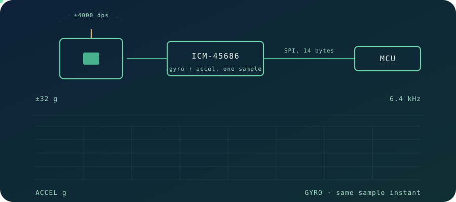

# mcu-imu

Read acceleration, angular velocity and temperature from a motion sensor, with timestamps and optional mapping into your board’s axes. Accelerometer-only devices report unavailable quantities as NaN.

**Platforms** · ESP-IDF 5.2+ and STM32 HAL (F4/F7). Hardware testing is pending. The host tests use simulated devices.

## Contents

- [Supported hardware](#supported-hardware)
- [Quick start](#quick-start)
- [Using the library in your project](#using-the-library-in-your-project)
- [License](#license)

## Supported hardware

The bus column lists the interfaces the driver supports. The example links show which bus each program uses. All drivers return a timestamped `imu_sample` through `imu_read()`. [Shared API](include/imu.h)

| Chip | Bus | Notes | Driver header | ESP-IDF project | STM32 HAL example |
|---|---|---|---|---|---|
| [MPU-6050](docs/chips.md#mpu-6050) | I2C | InvenSense 6-axis IMU | [mpu6050.h](include/mpu6050.h) | [I2C](examples/esp/mpu6050/) | [I2C](examples/stm/mpu6050/main.c) |
| [ICM-45686](docs/chips.md#icm-45686) | SPI | TDK InvenSense 6-axis IMU | [icm45686.h](include/icm45686.h) | [SPI](examples/esp/icm45686/) | [SPI](examples/stm/icm45686/main.c) |
| [BMI088](docs/chips.md#bmi088) | I2C or SPI | Bosch 6-axis IMU on two dies | [bmi088.h](include/bmi088.h) | [I2C](examples/esp/bmi088/) · [SPI](examples/esp/bmi088_spi/) | [I2C](examples/stm/bmi088/main.c) · [SPI](examples/stm/bmi088_spi/main.c) |
| [WT901C-TTL](docs/chips.md#wt901c-ttl) | UART | WitMotion attitude module | [wt901.h](include/wt901.h) | — | — |
| [ICM-42688-P](docs/chips.md#icm-42688-p) | I2C or SPI | TDK InvenSense 6-axis IMU | [icm42688.h](include/icm42688.h) | [SPI](examples/esp/icm42688/) | [I2C](examples/stm/icm42688/main.c) |
| [BMI270](docs/chips.md#bmi270) | I2C or SPI | Bosch 6-axis IMU | [bmi270.h](include/bmi270.h) | [I2C](examples/esp/bmi270/) | [SPI](examples/stm/bmi270/main.c) |
| [JY901](docs/chips.md#jy901) | UART or I2C | WitMotion attitude module | [jy901.h](include/jy901.h) | [UART](examples/esp/jy901/) | [I2C](examples/stm/jy901/main.c) |
| [LIS2DH12](docs/chips.md#lis2dh12) | I2C | ST 3-axis accelerometer, motion interrupt | [lis2dh12.h](include/lis2dh12.h) | — | — |

A dash marks a hardware and platform combination without a dedicated example.

## Quick start

Connect an MPU-6050 over I2C and match `PIN_SDA` and `PIN_SCL` to the wiring. The example uses address 0x68.

In a terminal with ESP-IDF activated, get the example and select the target for an ESP32. Change the target if your board uses another ESP32 chip.

```sh
git clone https://github.com/JonasAtelier/mcu-imu.git imu
cd imu/examples/esp/mpu6050
idf.py set-target esp32
```

Check the [wiring guide](docs/hardware.md) and edit the settings in [main.c](examples/esp/mpu6050/main/main.c) to match your board. Connect the board by USB, then build, upload and open the serial monitor.

```sh
idf.py build flash monitor
```

Rotate the board to see acceleration in m/s² and angular velocity in rad/s change. Apply sensor bias and scale calibration in your application.

<details>
<summary>STM32 HAL example for an initialised bus</summary>

Initialise the bus in your application, then probe the sensor, wait for a
fresh sample, and read it. This STM32 helper assumes the passed I2C handle is
already initialised. It polls for up to 200 ms, allowing time for the
MPU-6050's default 100 Hz sample rate:

```c
#include <errno.h>
#include <stdbool.h>

#include "imu.h"
#include "imu_log.h"
#include "mpu6050.h"

int read_once(I2C_HandleTypeDef *bus)
{
    static const struct mpu6050_config cfg = { 0 }; /* 0x68, defaults */
    struct imu_dev imu = { 0 }; /* Must start zeroed. */
    struct imu_sample sample;
    bool ready = false;
    int ret = mpu6050_probe(&imu, bus, &cfg);
    if (ret)
        return ret;

    for (unsigned int attempt = 0; attempt < 20; ++attempt) {
        HAL_Delay(10);
        ret = mpu6050_data_ready(&imu, &ready);
        if (ret || ready)
            break;
    }
    if (!ret)
        ret = ready ? imu_read(&imu, &sample) : -ETIMEDOUT;
    if (!ret)
        imu_log_sample(&imu, &sample);

    mpu6050_remove(&imu);
    return ret;
}
```

</details>

## Using the library in your project

- Add the component and enable the driver for your hardware. [Installation and build options](docs/installation.md)
- Open the ESP-IDF project for your hardware, or copy the STM32 example into a project with board setup already in place. [All ESP-IDF examples](examples/esp/) · [All STM32 examples](examples/stm/)
- Look up calls and chip-specific settings. [API usage](docs/usage.md) · [Hardware reference](docs/chips.md)

To run the simulated tests on your computer, run `make -C test test` from the library root. [Test requirements and coverage](docs/development.md)

## License

[MIT](LICENSE). The BMI270 driver carries Bosch Sensortec's configuration
file for the chip under the BSD 3-Clause licence; [NOTICE](NOTICE) has its
origin and Bosch's notice, which a firmware built with `IMU_BMI270` must ship
with.

<p align="center">
  
</p>

[Browse the workshop catalog · ESP32 and STM32 drivers](https://github.com/JonasAtelier/jonas-atelier-libraries#esp32-and-stm32-drivers)
