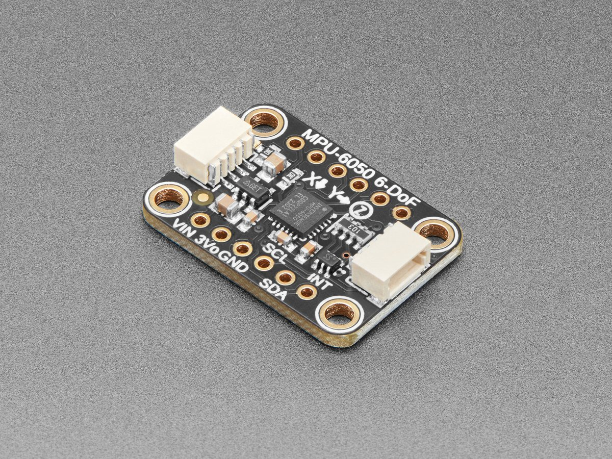
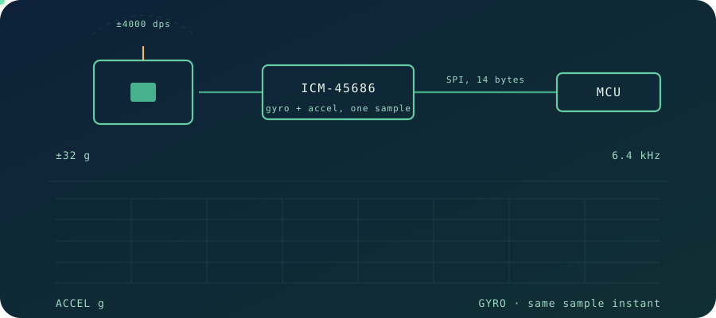
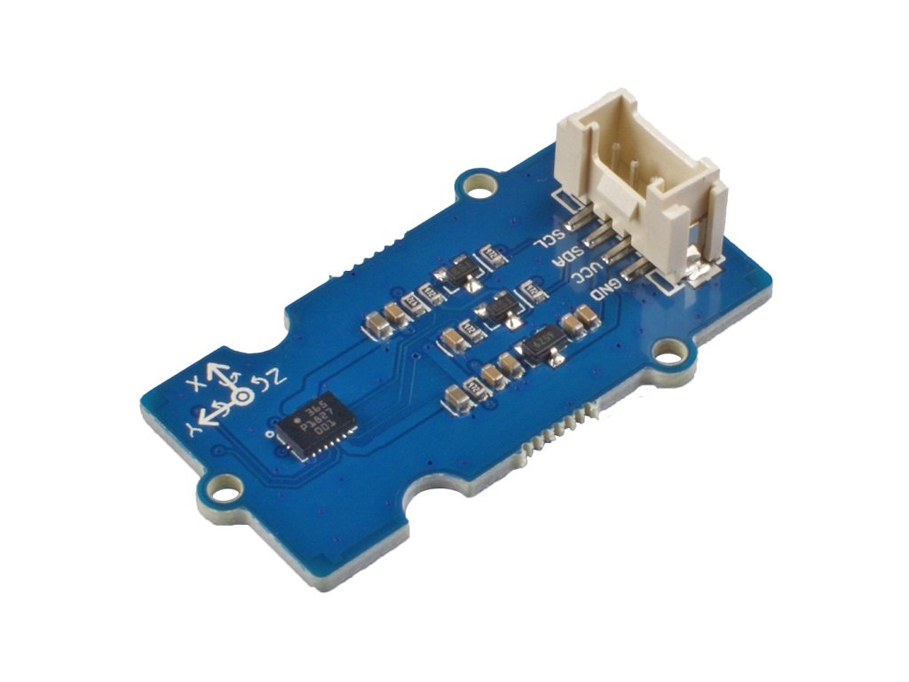

# Chip reference

[Back to README](../README.md)

Paths mentioned in this guide are relative to the repository root.

## MPU-6050

<p align="center">
  
  <br><sub>Adafruit MPU-6050 breakout &mdash; photo <a href="https://www.adafruit.com/product/3886">Adafruit Industries</a></sub>
</p>

The 6-axis IMU on every GY-521. Gyroscope to 2000 dps, accelerometer to 16 g,
over I2C. The mpu6050 examples stream all seven channels.

| Function | Does |
|---|---|
| `mpu6050_probe(&imu, bus, &cfg)` | Probe `WHO_AM_I`, reset, wake onto the gyro PLL, apply filter, rate and ranges |
| `mpu6050_remove(&imu)` | Put the chip to sleep and release it |
| `imu_read(&imu, &s)` | One burst, in m/s², rad/s and °C, mount applied |
| `mpu6050_read_raw(&imu, a, g, &t)` | The same burst as counts |
| `mpu6050_data_ready(&imu, &b)` | `INT_STATUS.DATA_RDY` |
| `mpu6050_set_ranges(&imu, a, g)` | Change either full scale |
| `mpu6050_set_rate(&imu, dlpf, hz)` | Filter and rate together — see below |
| `mpu6050_sample_rate(&imu)` | What the divider actually landed on |
| `mpu6050_sleep(&imu, bool)` | About 5 mA saved |
| `mpu6050_i2c_bypass(&imu, bool)` | Expose the auxiliary bus for a magnetometer |
| `mpu6050_accel_sensitivity` / `_gyro_sensitivity` | Counts per g / per dps currently in force |
| `mpu6050_reg_read` / `_reg_write` | Anything this driver does not model |

### The filter moves the sample rate

This is the part that catches people, and it is why filter and rate are set by
one call rather than two:

```
sample rate = gyro output rate / (1 + SMPLRT_DIV)

gyro output rate = 8 kHz   when DLPF is OFF or RESERVED
                 = 1 kHz   at every other filter setting
```

`DLPF_CFG` picks the low-pass filter **and** the base rate the divider works
from. Change the filter without re-solving the divider and the sample rate
moves by 8× — the part still streams, the numbers still look like data, and
nothing reports an error.

The reachable range is `base/256` to `base`, so:

- 10 Hz is **unreachable** with the filter off — 8000/256 = 31.25 Hz is the floor
- the same 10 Hz is fine at any other filter, where the base is 1 kHz
- and the other way, 2 kHz is **unreachable** at any filter but off: it is
  above the 1 kHz base. Exactly the base rate is fine

`mpu6050_set_rate()` returns `-EINVAL` for a rate it cannot reach rather than
quietly programming a different one, and warns if the 8-bit divider lands more
than 2% away from what you asked for. It writes the filter, then the divider;
if the second write fails, `mpu6050_sample_rate()` reports the rate the chip
is really running at, new filter and old divider.

### Ranges, and the temperature offset

Full-scale codes run the intuitive way here — code 0 is the **narrowest**
range, unlike the ICM-45686. Counts per unit is `32768 / full_scale`:

| Accel | counts/g | | Gyro | counts/dps |
|---|---|---|---|---|
| ±2 g | 16384 | | ±250 dps | 131 |
| ±4 g | 8192 | | ±500 dps | 65.5 |
| ±8 g | 4096 | | ±1000 dps | 32.8 |
| ±16 g | 2048 | | ±2000 dps | 16.4 |

Temperature is `raw / 340 + 36.53`. **The offset is 36.53, not 36** — Zephyr
rounds it, but Linux carries it exactly as `12420 / 340` and so does the
datasheet. Half a degree is not much, but it is a constant half degree.

### Two things about the burst

**Temperature sits in the middle.** The fourteen bytes from `ACCEL_XOUT_H` run
accelerometer, *temperature*, gyroscope — so the gyro block is at offset 8,
not 6. Read it as the obvious order and you get gyro bytes as temperature and
temperature bytes as gyro X, both of which look plausible.

**Byte order is big endian and fixed**, high byte first, with no configuration
bit. Refreshing, after the ICM-45686.

### The auxiliary bus

`mpu6050_i2c_bypass(&imu, true)` wires the chip's auxiliary bus straight
through to yours, so a magnetometer sitting behind it — an HMC5883L on a
GY-86, an AK8975 on an MPU-9150 — appears as an ordinary node at its own
address. The driver turns the internal I2C master off first, because bypass
does nothing while it is on.

That is as far as this goes. Driving the magnetometer is yours; this driver
does not know what is back there.

### What is not here

- **SPI.** The part has none. Its SPI-capable sibling is the **MPU-6000**, a
  different order code with the same register map.
- **The DMP.** Its firmware is an undocumented blob; a driver that ships one
  cannot tell you what it does.
- **The FIFO**, the motion detector, self-test, and the auxiliary bus's slave
  registers. All reachable through `mpu6050_reg_read`/`_write`.

### Provenance

Nothing here has been checked against a physical chip. Every register address,
bit position and constant appears in **two independent drivers** that agree:

- Zephyr's [`drivers/sensor/tdk/mpu6050/`](https://github.com/zephyrproject-rtos/zephyr/tree/main/drivers/sensor/tdk/mpu6050)
- The Linux kernel's [`drivers/iio/imu/inv_mpu6050/`](https://github.com/torvalds/linux/tree/master/drivers/iio/imu/inv_mpu6050)

They disagree on exactly one number: the temperature offset, where Zephyr uses
36.0 and Linux uses 12420/340 = 36.53. This driver follows Linux, which
matches the datasheet.

InvenSense's register map (RM-MPU-6000A-00) is the authority for all of it, but
every mirror I could reach refused a scripted download, so no copy ships here.

## ICM-45686

<p align="center">
  
</p>

A 6-axis IMU with a gyroscope to 4000 dps and an accelerometer to 32 g,
sampled together at up to 6.4 kHz, over SPI. The icm45686 examples stream all
seven channels.

| Function | Does |
|---|---|
| `icm45686_probe(&imu, &cfg)` | Reset, check `WHO_AM_I == 0xE9`, pin the byte order, apply ranges, start both sensors |
| `icm45686_remove(&imu)` | Power both sensors off and release the device |
| `imu_read(&imu, &s)` | One burst, in m/s², rad/s and °C, mount applied |
| `icm45686_read_raw(&imu, a, g, &t)` | The same burst as counts |
| `icm45686_data_ready(&imu, &b)` | `INT1_STATUS0.drdy` |
| `icm45686_set_ranges` / `icm45686_set_odr` | Change scale or rate at runtime |
| `icm45686_set_power(&imu, accel, gyro)` | Turn either sensor off |
| `icm45686_accel_sensitivity` / `_gyro_sensitivity` | Counts per g / per dps currently in force |
| `icm45686_reg_read` / `_reg_write` | Anything this driver does not model |

### The full-scale codes run backwards

This is the one thing worth reading before you use the part:

```
ICM45686_ACCEL_FS_32G = 0     ICM45686_GYRO_FS_4000DPS   = 0
ICM45686_ACCEL_FS_2G  = 4     ICM45686_GYRO_FS_15_625DPS = 8
```

Code **0 is the widest range**, not the narrowest — the opposite of nearly
every other IMU. Read a scale factor off the wrong end of the table and every
sample is wrong by a power of two, with nothing anywhere reporting an error.
The enum names carry their values so you never have to remember the direction,
and `test/test_icm45686_math.c` asserts it explicitly.

Both sensors are 16-bit signed with full scale at the ends of the range, so
counts per unit is `32768 / full_scale`. At ±2 g that is 16384 counts per g;
at ±32 g it is 1024, and a quiet desk reads as noise.

**Pick the narrowest range that will not clip.** A clipped sample looks exactly
like a real one.

### Byte order is pinned, not assumed

`SREG_CTRL` bit 1 selects whether the data registers are laid out big or
little endian. A driver that assumes one and meets the other returns numbers
that look like data and are not — the sign flips and the magnitude is
nonsense, but nothing errors.

So `icm45686_probe()` writes it explicitly rather than trusting a reset
default. That register lives at `0xA267`, above the direct register space, so
the driver carries a small indirect-access path (`IREG_ADDR`, `IREG_DATA`,
poll `REG_MISC2.ireg_done`) purely to reach it. Little endian is written
because it is also the reset default: if that write ever fails, the driver
logs a warning and behaviour is unchanged rather than silently inverted.

### What is not here

- **I2C and I3C.** SPI only. The part speaks all three; one transport with no
  indirection reads better than three behind an ops table, and at 6.4 kHz you
  want SPI anyway.
- **The FIFO.** `imu_read()` polls the data registers. For sustained
  high-rate capture you want the FIFO, and it is reachable through
  `icm45686_reg_read`/`_write`.
- **APEX / eDMP** — pedometer, tilt, tap, wake-on-motion.
- **The AUX interface**, for an external magnetometer or an OIS controller.
- **Self-test**, and the factory bias registers.

### Provenance

Nothing here has been checked against a physical chip. What the numbers *are*
checked against:

- Register addresses and bit positions are transcribed from TDK InvenSense's
  own reference driver,
  [`inv_imu_regmap_le.h`](https://github.com/tdk-invn-oss/motion.mcu.icm45686.driver).
- Every one of them was then cross-checked against
  [Zephyr's independent driver](https://github.com/zephyrproject-rtos/zephyr/tree/main/drivers/sensor/tdk/icm45686).
  The two agree on all of it.
- `WHO_AM_I == 0xE9` comes from **Zephyr alone** — TDK's driver only returns
  the register and never states the expected value. It is the one constant
  here without a second opinion.
- The temperature scaling, 132.48 LSB/°C with zero at 25 °C, is from Zephyr's
  `icm45686_temp_c()`.

The TDK datasheet (DS-000577) and user guide (AN-000478) are behind a consent
gate that refuses scripted download, so neither ships here. Fetch them by hand
before trusting any of the above.

## BMI088

<p align="center">
  
  <br><sub>Grove BMI088 module &mdash; photo <a href="https://wiki.seeedstudio.com/Grove-6-Axis_Accelerometer&amp;Gyroscope_BMI088/">Seeed Studio</a></sub>
</p>

Bosch's two-die IMU: an accelerometer to 24 g and a gyroscope to 2000 dps,
over I2C (the bmi088 examples) or SPI (the bmi088_spi ones). Register
behaviour and timing follow Bosch BMI088 Data Sheet rev 1.9. **The driver
carries both transports, so `IMU_BMI088` needs both `HAL_I2C_MODULE_ENABLED`
and `HAL_SPI_MODULE_ENABLED`**, even if you wire only one; the build stops
with an `#error` naming them otherwise.

### How it measures

The accelerometer measures **specific force** along three body axes. A
supported, level sensor with +Z pointing up reports about **+9.81 m/s² on Z**,
even at rest. It does not directly report gravity-free motion acceleration.
The gyroscope measures **angular rate**, not an angle or orientation: once a
turn stops, its ideal output returns to zero even though the sensor now faces
another way. Both hold for every chip here; the BMI088 is just where the
picture lives.



The illustration assumes the sensing point lies on the vertical rotation axis,
with no translation or tilt. The turn is +45°/s = π/4 ≈ +0.785 rad/s; its drawn
heading is explanatory, **not an API output**. Real readings include noise and
bias. Each six-second replay resets the drawing; the reset is not a measured
reverse turn. Reduced-motion viewers see the final stopped pose.

| Inside one BMI088 package | I2C addresses | SPI selection | Output |
|---|---|---|---|
| Accelerometer die | `0x18` or `0x19` | CSB1 | `imu_sample.accel` (x, y, z) |
| Gyroscope die | `0x68` or `0x69` | CSB2 | `imu_sample.gyro` (x, y, z) |

Both dies share the bus but are addressed separately. `imu_read()` on a BMI088
reads acceleration, angular rate, then temperature **sequentially**; it does
not synchronize the dies or provide an orientation estimate. Polling both
ready bits also does not make their samples simultaneous.

| Function | Does |
|---|---|
| `bmi088_probe_i2c(&imu, &bus_cfg, cfg)` | Check both dies ACK at their addresses, check both chip IDs, reset, configure, verify |
| `bmi088_probe_spi(&imu, &bus_cfg, cfg)` | The same over SPI, after one throwaway read that switches the accelerometer to SPI |
| `bmi088_remove(&imu)` | Release the driver's state; the bus is left alone |
| `imu_read(&imu, &s)` | Sequential accel, gyro and temperature reads, mount applied |
| `bmi088_read_accel(&imu, &v)` | m/s², chip frame |
| `bmi088_read_gyro(&imu, &v)` | rad/s, chip frame |
| `bmi088_read_accel_raw` / `_gyro_raw` | Counts |
| `bmi088_read_temperature(&imu, &t)` | °C; `-ERANGE` for the invalid code |
| `bmi088_data_ready(&imu, &mask)` | `BMI088_DATA_READY_ACCEL` / `_GYRO` bits; poll before reading |
| `bmi088_default_config()` | Starting config to modify |

Every int-returning call returns `0` or a negative errno;
`strerror(-ret)` names it. **Do not use sample values when a call returns an
error.** Outputs are only updated after the full operation succeeds.

`cfg` may be `NULL` for the defaults: accelerometer ±6 g, 100 Hz, normal
filter; gyroscope ±2000 °/s, 200 Hz ODR / 23 Hz bandwidth. Otherwise start
from `bmi088_default_config()` and change only the fields you need. Zero I2C
bus fields select defaults too: addresses `0x18`/`0x68`, 100 ms timeout. Bus
speed and SPI mode are the handle's: I2C at 400 kHz or less, SPI in mode 0 or
3 with 8-bit frames at 10 MHz or less. The probe refuses any other SPI mode
or frame size, or one CS pin for both dies, with `-EINVAL`.

### Wiring

The BMI088 has two separate dies. Both must be connected. The full pin
tables are in the [wiring guide](hardware.md#pins).

**I2C.** Defaults are `0x18` (accel) and `0x68` (gyro); tie SDO1/SDO2 to
VDDIO for `0x19`/`0x69`. **External pull-ups are required on SDA and SCL** —
the example only turns on the STM32's weak internal ones.

**SPI.** SCK, MOSI, MISO to the SPI bus. CSB1 and CSB2 to two GPIO outputs,
PS to GND, and **pull-ups on both chip selects** so neither die is selected
while the STM32 boots. Mode 0 and mode 3, up to 10 MHz.

## WT901C-TTL

WitMotion's "WT901 Attitude Angle Sensor SPECIFICATION", in `docs/WT901.pdf`
(not committed). It is for the WT901 core; no C-TTL-specific manual was
found, and the cased C-TTL is assumed to speak the same serial protocol.
Every byte, register and scale in `src/wt901/wt901_proto.h` and `src/wt901/wt901.c`
cites its section and page. Serial only: the core's IIC mode (chapter 7) is
not supported.

**Wiring and link.** The app sets the UART up: 9600 bps out of the box, no
parity (chapter 6, p.30), TTL levels — never RS232. `wt901_probe()` takes a
`uart_port_t` with its driver installed on ESP-IDF, or a
`UART_HandleTypeDef *` on the HAL.

**It streams; the driver reads the stream.** The module sends 11-byte
frames on its own — 0x55, a type, eight data bytes, a SUM (§6.1) — at 10 Hz
by default (§6.2). The PDF has no serial command to read a register, and
switching the output off takes a save and a power cycle (§6.2.9), so the
probe writes nothing to the module. The driver looks at the stream through
an 11-byte window and takes a frame only when the header, a known type
(0x50-0x5A) and the SUM all check out; otherwise it slides to the next 0x55
in the window, so a read that starts mid-frame, line noise, or a 0x55 inside
the data cannot throw it off. Each read looks at most 256 bytes.

**`imu_read()`** drops what was already waiting, then takes the next
accelerometer (0x51) and gyroscope (0x52) frames in either order: up to one
output period plus two frames, about 125 ms at 9600 bps and the default
10 Hz. The effective sample rate never exceeds the module's output rate; a
faster loop blocks. The two are consecutive frames, not one instant. Scales are §6.1.2-6.1.3: ×16/32768 g, using this library's
`IMU_G` (the PDF writes g as 9.8 m/s²), and ×2000/32768 °/s; temperature is
the accelerometer frame's, /100 °C.

**Errors.** Silence at probe is `-ENXIO`, a stream that stops later
`-ETIMEDOUT`. Bytes whose frames never pass the SUM — usually the wrong baud
rate — are **`-EBADMSG`**. Valid frames without 0x51 and 0x52 — their output
switched off in the module's return content (§6.2.8) — are `-ENODATA`.

**Extras.** `wt901_read_angles()` is the module's own roll, pitch and yaw
(the 0x53 frame, §6.1.4). `wt901_command(address, value)` sends 0xFF 0xAA
address dataL dataH (§6.2) for everything else — content, rate, calibration,
biases; several only take effect after a save and a power cycle.
`wt901_config.timeout_ms` (0 is 200 ms) must cover an output period if you
slow the module down.

**Gaps in the PDF**, filled with a stated assumption:

- The SUM. §6.1.2, 6.1.3, 6.1.4 and 6.1.10 give 0x55 + the type + the eight
  data bytes; the other frames' formulas name the wrong type and are taken
  as typos. The PDF never says the sum is cut to a byte; SUM is one byte, so
  the low 8 bits are compared.
- §6.1.4 is titled "Angular Velocity Output" but is the angle frame.
- The PDF gives no order for the frames in a cycle, so none is assumed.
